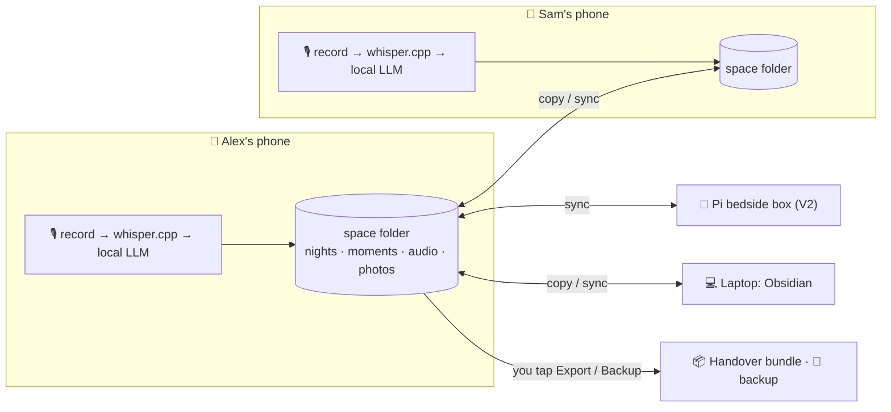

# Architecture

## Guiding idea: process on the phone, share plain files

- A couple (or family) shares one **space**. **Any** member's Android phone can record.
- The phone that records does all the processing itself: transcription (whisper.cpp) and moment
  extraction (a small local language model). There are no servers and no cloud AI.
- The result is plain Markdown notes: one **night note** (audio, transcript, links) and one
  **moment note** per moment. See the [file formats](session-file-format.md).
- **Files are the source of truth.** The space is a folder shared between your devices. Each
  phone's database is only an index rebuilt from it.
- **Laptop: Obsidian.** The space folder is also an Obsidian vault, so viewing, editing, comments,
  boards and albums work on a computer with no extra app.
- **V2:** the Raspberry Pi bedside box is just another device in the space. It records,
  processes and writes notes the same way.



All devices run the same **shared Kotlin core** (data model, prompts, stats, file formats,
export) and the same kind of engines: whisper.cpp for speech-to-text and a small local LLM.

## Sharing between phones

The app only reads and writes files in the space folder. Moving them between devices is the job
of a sync layer, outside the app.

- **Start: manual copying** over USB (details in [syncing](session-file-format.md#syncing)).
- **Later: Syncthing**, chosen over a Git repo:

| | **Syncthing** ✅ chosen | Private Git repo (e.g. GitHub), not planned |
|---|---|---|
| Where the data lives | Only on your devices | Your devices **plus GitHub's servers** |
| Audio | Syncs too, so ▶️ works on both phones | Stays on the recording phone (~2 GB a year is too big for git) |
| Network permission for our app | **None.** The Syncthing app does the syncing, end-to-end encrypted. | Needed, plus a GitHub token on each phone |
| When it syncs | When devices are online at the same time. At home on Wi-Fi every evening that's enough. | Any time, any network |
| Extras | Every device holds a full copy, which doubles as a backup | Full edit history, readable on github.com |
| Setup | Install [Syncthing-Fork](https://f-droid.org/packages/com.github.catfriend1.syncthingfork/) on both phones and share one folder | Create a private repo and a fine-grained token per phone |

**Why Syncthing:** it keeps the "nothing leaves our devices" promise, lets the audio come
along, and our app stays permission-free. Syncthing's own file versioning can be switched on
for a basic edit history.

**Setting it up.** The app asks for the space folder once, through the system folder picker,
and remembers it. Pick a normal folder like `Documents/dream2gether-space`, so it's visible over
USB, and later to Syncthing.

## Laptop: Obsidian

- **What it is.** The space folder is an [Obsidian](https://obsidian.md) vault. Obsidian is a
  free, local-first Markdown app for desktop and mobile.
- **Why not Electron or a web app.** An Electron app would mean building the UI twice in a
  second language. A web app would need a server, or couldn't open the folder on the phone.
  Obsidian costs zero code.
- **What you get there:**
  - read and edit moments;
  - ⭐ stars and `==highlights==`;
  - 💬 comments;
  - albums, projects and artworks (collection notes);
  - free-form boards (Canvas);
  - database-style views (Bases);
  - the audio player.
- **The app's side.** It must read whatever Obsidian writes. It parses front matter and known
  sections, and keeps everything else untouched.
- **Later.** If we want our own desktop app, build it with Compose Multiplatform from the same
  Kotlin code as the Android app.

## Processing steps (on the recording phone)

Each recording is a **session** moving through
`recorded → transcribed → extracted → (reviewed)`.
Audio and transcripts are kept, so every step can be re-run. When a better model comes out, or
German arrives, old nights can be re-processed and only gain from it. Moments edited by hand are
never overwritten.

1. **Capture**
   - `MediaRecorder` records AAC in `.m4a`, mono, ~64 kbps. That plays anywhere and is about
     0.5 MB per minute.
   - Recording runs in a foreground service of type `microphone`. Its notification doubles as
     the "mic is on" indicator.
   - Auto-stop after ~3 min of silence, with a hard cap of 30 min.
2. **Schedule**
   - A WorkManager job runs **while charging**, so processing happens overnight on the
     nightstand.
   - A "process now" button runs it immediately.
3. **Decode**
   - `MediaExtractor`/`MediaCodec` converts the audio to 16 kHz mono PCM for the speech model.
   - The temporary file is deleted afterwards; the `.m4a` stays.
4. **Transcribe**
   - whisper.cpp through JNI with an English model (`small.en`, or `base.en` on lighter phones),
     voice-activity detection on.
   - The output is segments with timestamps and language.
5. **Extract moments**
   - The local LLM uses constrained decoding: output is forced to match a JSON schema, so it
     always parses.
   - Input:
     - numbered transcript segments;
     - recording date and weekday;
     - tonight's question;
     - the members' names;
     - the glossary from `space.md`;
     - titles of recent moments from the whole space, so repeats get linked instead of
       duplicated.
   - Each moment cites the segments it came from. That's what powers ▶️ "hear it".
6. **Write the night note, moment notes and audio** into the space folder. Copying or sync
   carries them to the other devices.
7. **Monthly recap**
   - Whichever phone notices changes regenerates the month note `months/YYYY-MM.md`. Your
     journal edits are kept.
   - Stats are computed in code. The LLM writes only the title, the journal and the playful
     lines, from non-private moments.
8. **Export / backup**: see [handover format](journal-handover-format.md) and
   [backup](#backup--restore).

### Working with a small model

A 2–4B-parameter on-device model is capable but needs a gentle setup:

- **Constrained JSON output.** The schema is enforced while decoding, so there's no parsing
  roulette.
- **Do the arithmetic in code.** The model reports a date *reference* (`yesterday`,
  `weekday:saturday`, `date:2026-10-17`, `unknown`). The core resolves it against the recording
  date. Counting, streaks and stats are code, never the model.
- **Enums for categories.** The model picks from the fixed list in
  [concept.md](concept.md#categories); free tags are optional.
- **Short prompts.** Use one worked example and one task per call.
- **Chunk long nights.** Split transcripts longer than ~10 min into ~5-min windows. Code then
  merges moments that overlap in segments or titles.
- **Record what produced each result.** Each night note records the model and prompt version,
  to know what to re-run. Moment notes carry a `generated_hash`, so re-processing replaces only
  moments nobody edited.

### Extraction output (draft)

The model returns JSON. The core turns it into moment notes.

```json
{
  "moments": [
    {
      "title": "Storm watching with tea",
      "description": "We sat by the window with ginger tea and counted the seconds between lightning and thunder.",
      "day_ref": "weekday:saturday",
      "day_ref_end": null,
      "approx": false,
      "categories": ["cozy", "us"],
      "places": ["home"],
      "people": [],
      "emoji": "⛈️",
      "quote": "Eleven seconds! It's moving away.",
      "is_first_time": false,
      "photo_hint": "window, rain, two mugs",
      "segments": [14, 15, 16, 17],
      "same_as_recent": null
    }
  ],
  "dreams": [
    { "text": "Go back to the thermal baths before Christmas", "segments": [21] }
  ]
}
```

## Any Android phone

- **No minimum phone.** Each phone picks model sizes by its RAM: `small.en` plus a ~4B LLM on
  roomier phones, `base.en` plus a ~2B LLM on lighter ones. A slower phone just takes longer
  overnight.
- **Mixed models are fine.** The night note records which models processed it.
- **Catching up later.** If a light phone recorded a night, any device can re-process it later,
  for example with a bigger model on the V2 box.

## Models & runtimes

| Job | Android | Raspberry Pi (V2) |
|---|---|---|
| Speech-to-text | whisper.cpp via JNI, `small.en` / `base.en` | whisper.cpp, same model or larger |
| LLM | [LiteRT-LM](https://developers.googleblog.com/blazing-fast-on-device-genai-with-litert-lm/) with a small Gemma model (e.g. Gemma 4 E2B / E4B). It supports constrained decoding and is light on memory. llama.cpp is the fallback. | llama.cpp with a GGUF model. A Pi 5 with 16 GB can run a bigger model overnight. |

- **Swappable.** Both engines sit behind interfaces in the core (`SpeechToText`,
  `LanguageModel`), so the laptop test decides the actual pick.
- **Installed once, never downloaded by the app.** Models are copied onto each phone once
  (`adb push`, or downloaded in a browser and imported via the file picker).

## Shared core (`core/`)

Pure Kotlin, using `kotlinx.serialization` and `kotlinx-datetime`, with no Android APIs:

- the space, night, moment and collection note formats (read and write, tolerant of
  Obsidian edits);
- prompts, schemas, and date-reference resolution;
- the moment merge logic and conflict detection;
- recap stats and the monthly handover file;
- the backup format;
- the step-by-step processing logic, written against engine and storage interfaces.

It runs on Android, on the Pi's JVM, and via Kotlin Multiplatform on iOS later.

## Index database (per phone)

A Room database **rebuilt from the files**, for fast lists, search and the recap screen. It's
never synced and never backed up: delete it and it rebuilds.

```
Session   id, file_path, recorded_by, recorded_at, duration_s, language, audio_path?, status
Moment    id, session_id, title, happened_on, happened_on_end?, date_confidence, who,
          categories[], places[], people[], emoji, starred, private, edited,
          audio_start_ms, audio_end_ms
Photo     moment_id, file_path
Dream     id, text, status, fulfilled_by_moment?
FileSeen  path, modified_at, hash        (to notice synced changes)
```

## Storage

| What | Size (rough) | Where |
|---|---|---|
| Audio, 10 min a night | ~5 MB per night, **~2 GB per year** | space folder |
| Night and moment notes | a few KB each | space folder |
| Photos | as picked | space folder |
| Speech model + LLM | ~2–3.5 GB | each phone, app-private |
| Index database | small | each phone, app-private |

## Privacy guarantees (and how to check them)

| Guarantee | How |
|---|---|
| Our app cannot talk to any network | No `INTERNET` permission, enforced by Android. Syncthing does the syncing, end-to-end encrypted between your devices. |
| No cloud AI | Speech-to-text and the LLM run on the device. |
| No silent cloud backup | `allowBackup="false"`, plus data-extraction rules that exclude everything. |
| No third-party code phoning home | No analytics, ads or crash-reporting SDKs. Dependencies are reviewed. |
| The mic is on only when someone presses the button | A foreground service started by the button, with a visible notification, auto-stop and a hard cap. |
| The app sees only the photos you pick | Android Photo Picker, no gallery permission. |
| Private moments stay inside the space | Excluded from recaps and exports. |
| Exports go only where you put them | The system file picker chooses the destination. The app warns when that destination is a cloud folder. |
| Nobody else opens the journal | Optional biometric app lock. |

## Backup & restore

- **Every device holding the space is a full copy.** Two phones and a laptop means three
  copies, whether you copy by hand or use Syncthing.
- **For a copy that survives losing every device:** export an encrypted archive
  (`dream2gether-backup-YYYY-MM-DD.d2g`) to a USB stick or computer. It's the space folder,
  encrypted with a passphrase you choose. A gentle monthly reminder nudges you.
- **New phone:** copy the space folder onto it (or add it to Syncthing later), or restore the
  archive.

## V2: the bedside box

- **One more device in the space.** The box records, transcribes, extracts and writes notes
  exactly like a phone. Both phones see its nights through the same sync.
- **Firewalled.** The box's firewall blocks all outbound internet traffic; Syncthing works on
  the home network. Updates are a deliberate, manual step.
- **Re-processing.** It can re-run old nights from lighter phones with bigger models.

**Hardware (draft bill of materials)**
- Raspberry Pi 5. Get the 16 GB model if you want a bigger LLM.
- An NVMe SSD (via an M.2 HAT) for the space folder.
- A **passive** cooling case. A fan humming next to the bed is a deal-breaker.
- Microphone: an omnidirectional USB conference mic. A mic HAT also works; check Pi 5 driver
  support before buying.
- 1–2 large arcade buttons with built-in LED, on GPIO.
- Optional: a small e-ink display. It shows tonight's question and *"3 new moments ✨"* in the
  morning, and emits no light at night.
- Optional: an LED ring (slow breathing while recording, one warm blink when moments are ready).

**Talking-stick mode.** With one button per partner, you hold yours while you speak. That gives
perfect who-said-what attribution, and it's a bit of a game.

## Languages

- **V1, English.** Uses English-only Whisper models, which are smaller and more accurate for
  English, plus English prompts and examples.
- **German and Dutch.**
  - Switch to a multilingual Whisper model; both languages are well supported. Set the language
    in `space.md`.
  - Add per-language prompts, examples and category labels, and translate the UI strings.
  - Before shipping, check the local LLM's German and Dutch writing on the test set.
- **Mixing languages mid-sentence** ("we went to the *markt*, so *gezellig*"). Whisper picks
  one language per ~30-second window. It tends to write everything in that language, sometimes
  translating the other one's words. Things to try:
  - leave the language unpinned;
  - give the model an initial prompt that itself mixes languages;
  - use bigger models on the box;
  - try newer speech models that handle mixing, if there are good on-device ones by then.

  Build a test set of real mixed evenings first. Because audio is kept, all earlier nights can be
  re-transcribed once it works.

## Integrations stay outside the app

The app works on a private folder. The handover bundle is the only thing designed to leave the
space, and only when you export it. Integrations work on the bundle, separately from the app.
For example, a small companion script on a computer could later turn a month's bundle into a
Google Photos album. That still works under Google's 2025 Library API rules, because an app may
create albums and upload photos itself. It just can't search your existing library.

## Build plan

| Step | What | Why first |
|---|---|---|
| **M0** | Laptop test, fully offline: whisper.cpp plus 2–3 candidate LLMs on 3–5 real (or role-played) English evenings. Output is real night and moment notes, opened in Obsidian. | Picks the models and prompt, settles the file format, sets up the Obsidian starter kit |
| **M1** | Android recorder: choose space folder, record, auto-stop, write audio plus a bare night note, list and play nights (including ones copied over from the other phone) | Both of you start collecting nights from week one |
| **M2** | On-device transcription and extraction overnight; write moment notes | The core of the idea |
| **M3** | Moments inbox, editing, stars, highlights, comments, collections, conflict prompt, ▶️ playback, photos, share card | Day-to-day use |
| **M4** | Monthly recap file and screen, handover export, encrypted backup | The payoff, and safety |
| **M5** | Evening questions, bedtime reminder, polish | Making it a habit |
