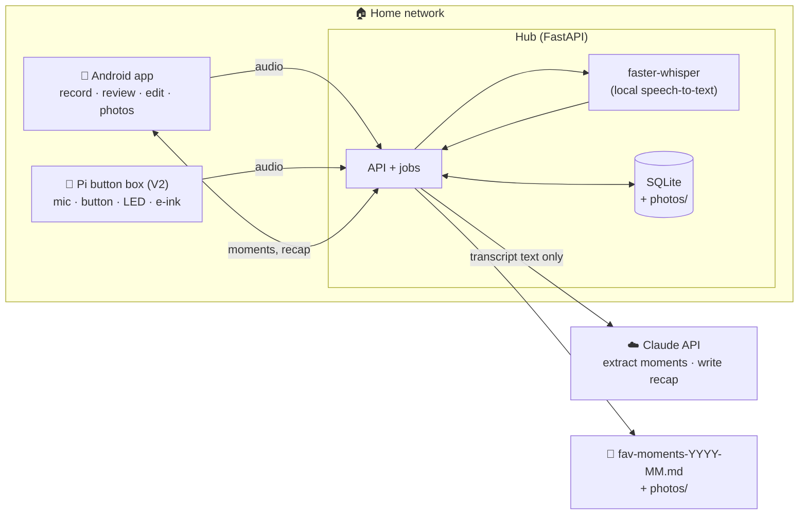

# Architecture

## Guiding idea: one hub, many front doors

All the logic (transcribe → extract → store → recap → export) lives in one small Python service
called the **hub**. Capture devices are just front doors:

- **V1:** the Android app records and uploads to the hub.
- **V2:** a Raspberry Pi button box records into the same hub, and can also *be* the hub.

The app is always where you browse, edit and export.



**Why not phone-only?** It would be quicker for a first weekend, but:
- the API key would live on the phone;
- the pipeline would have to be rewritten for the Pi;
- both partners' phones couldn't easily share the same journal.

With a hub from day one, V2 is "add a button", not "start over".

## Pipeline

Each recording is a **session** moving through
`recorded → uploaded → transcribed → extracted → (reviewed)`.
Every step is idempotent and re-runnable, so a better prompt next month can be re-applied to old
transcripts.

1. **Capture**
   - App: `MediaRecorder`, AAC mono, 16 kHz, ~32 kbps (≈15 MB/hour).
   - Hard cap 30 min. Auto-stop after ~3 min of silence.
   - Uploads go through a WorkManager queue, so recording works even when the hub is offline.
2. **Preprocess**
   - `ffmpeg` converts to 16 kHz mono WAV with loudness normalisation, because bedtime voices
     are quiet, sometimes whispered.
3. **Transcribe**
   - faster-whisper, multilingual `small` model, int8, VAD filter on.
   - The language is pinned per couple (e.g. `de`) to avoid misdetection on quiet audio.
   - Segments are stored with timestamps.
   - Raw audio is deleted afterwards unless "keep this night" is on.
4. **Extract moments**: one Claude call per session.
   - Input:
     - transcript;
     - recording date and weekday (to resolve "on Saturday" to `2026-10-17`);
     - tonight's question;
     - your names;
     - a small glossary of known people and places, so "Rosi" is spelled the same every time;
     - recent moments, so repeats can be linked instead of duplicated.
   - Output: structured JSON (schema below), validated against a Pydantic model.
5. **Review (optional)**
   - Moments are visible right away. Any field you edit is marked `edited_by_human`, and
     re-extraction never overwrites it.
6. **Monthly recap**
   - Stats are computed in code: counts, streaks, categories, cast and places.
   - Claude writes only the title, the journal narrative and the playful lines. It works from
     the reviewed moments, not the raw transcripts. Private moments are never sent.
7. **Export**
   - Renders the [handover file](journal-handover-format.md) and copies the photos into a
     `fav-moments-YYYY-MM/` bundle (also offered as a zip in the app's share sheet).

### Extraction output (draft)

```json
{
  "session_summary": "Cozy recap of a stormy weekend",
  "moments": [
    {
      "title": "Storm watching with tea",
      "description": "We sat by the window with ginger tea and counted the seconds between lightning and thunder.",
      "happened_on": "2026-10-17",
      "happened_on_end": null,
      "date_confidence": "exact",
      "who": "both",
      "categories": ["cozy", "us"],
      "places": ["home"],
      "people": [],
      "emoji": "⛈️",
      "quote": "Eleven seconds! It's moving away.",
      "quote_by": "sam",
      "is_first_time": false,
      "photo_hint": "window, rain, two mugs",
      "relates_to_moment_id": null
    }
  ],
  "dreams": [
    { "text": "Go back to the thermal baths before Christmas" }
  ]
}
```

`date_confidence` is `exact | approx | unknown`. Good dates matter: they drive the calendar of
hearts and, later, photo matching.

## Data model (draft)

```
Couple    names (a, b), language, timezone, bedtime_reminder, glossary (people/places)

Session   id, recorded_at, duration_s, question_id, audio_path?, keep_audio,
          transcript (segments json), status, error?

Moment    id, session_id, title, description, happened_on, happened_on_end?,
          date_confidence, who (both|a|b), categories[], tags[], places[], people[],
          emoji, quote?, quote_by?, is_first_time, photo_hint?,
          starred, private, hidden, merged_into?, edited_fields[], created_at, updated_at

Photo     id, moment_id, file_path, taken_at?, caption?, sort

Dream     id, text, created_from_session?, status (open|done), fulfilled_by_moment?

Recap     month (YYYY-MM), title, journal_md, stats (json), edited_by_human, generated_at

Question  id, text, kind (nightly|random|weekly|monthly|special), last_asked_at
```

The hub's SQLite database is the source of truth. The app keeps a Room cache for offline
browsing.

## Tech stack (recommended)

| Part | Pick | Why |
|---|---|---|
| Hub | Python 3.12, FastAPI, SQLite (SQLModel), Docker Compose | Whisper and the Anthropic SDK are Python-first. SQLite is plenty for two people. The same container runs on a laptop or a Pi. |
| Speech-to-text | faster-whisper `small` (`medium` on a laptop) | Audio never leaves the house, and it handles German and English well. |
| LLM | Claude API (`claude-opus-5-5`) with structured outputs (Anthropic Python SDK) | Gives warm, nuanced writing and reliable JSON. Cost is negligible at this volume (see below). |
| App | Kotlin + Jetpack Compose, Room, WorkManager, Ktor client | Native audio recording and photo picker, offline-tolerant uploads. If an iPhone is involved: Flutter. |
| Networking | Home LAN, [Tailscale](https://tailscale.com) for access from outside | No port forwarding, and nothing is exposed to the internet. |
| Jobs | In-process queue (e.g. a simple SQLite-backed worker) | No Redis or Celery needed for two people. |

## Cost estimate (Claude)

A 10–15 min chat is ~2,000 words, roughly 3–5k tokens. With the prompt that's ~6k input tokens
and ~2–3k output tokens (including thinking) per night. At $4 / $20 per million tokens that's
about **$0.07 per night**, so **~$2 per month** if you record every night. The monthly recap adds
a few cents.

## Privacy & trust

- **Explicit start only.** Recording starts only on a press. While it runs there's a visible
  indicator: a pulsing dot in the app, the LED on the box.
- **Always stops.** Silence auto-stop plus a hard cap. It must never record a whole night.
- **Audio stays home.** Transcription runs locally and audio is deleted after transcription by
  default.
- **Only text leaves the house.** The transcript goes to the Claude API for extraction. Private
  moments are excluded from recaps and exports.
- **Key on the hub.** The API key lives on the hub only, never in the app.
- **Not on the internet.** The hub is reachable on the LAN (or Tailscale) only.
- **Delete anything.** "Forget this night" and "delete this moment" remove everything,
  including transcript and photos.
- **Both of you opt in.** Either partner can pause the whole thing.

## V2: the bedside box

**Hardware (draft bill of materials)**
- Raspberry Pi 5 (8 GB).
- A **passive** cooling case. A fan humming next to the bed is a deal-breaker.
- Microphone: an omnidirectional USB conference mic. A mic HAT also works; check Pi 5 driver
  support before buying.
- 1–2 large arcade buttons with built-in LED, on GPIO.
- Optional: small e-ink display. It shows tonight's question and *"3 new moments ✨"* in the
  morning, and emits no light at night.
- Optional: LED ring (slow breathing while recording, one warm blink when the moments are
  ready).

**Software (`box/`)**
- A `gpiozero` daemon. Press to start (LED breathes), press to stop, long-press to discard.
- Audio is recorded with `sounddevice`/`arecord` and dropped into the hub's inbox, so it runs
  through the same pipeline.
- Transcription on the Pi is slower than on a laptop. That doesn't matter: it runs while you
  sleep and results are there in the morning. Heavy jobs can be offloaded to a laptop or a
  cloud STT if needed.

**Talking-stick mode.** With one button per partner, you hold yours while you speak. That gives
perfect who-said-what attribution with no speaker diarization, and it's a bit of a game.

## Google Photos (later): what's possible

Since March 2025 the Google Photos **Library API** only lets an app read and manage media and
albums **it created itself**. Apps can no longer search a user's whole library ("all photos from
18 Oct"). What still works:

- **Picking:** the user chooses photos, either via the Android Photo Picker (which shows Google
  Photos cloud items on Android 12+) or via the Google Photos **Picker API**.
- **Creating the album:** upload those photos into an **app-created album**
  (`photoslibrary.appendonly`), e.g. *"Fav moments · October 2026"*.

The handover file's [album plan](journal-handover-format.md#album-plan) (dates, picked photos,
search hints per moment) is designed for exactly this flow.
