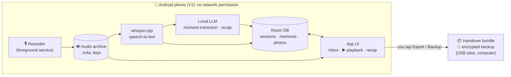
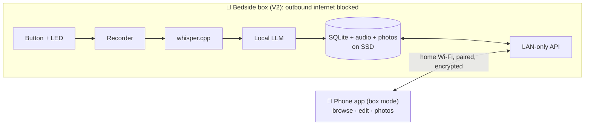

# Architecture

## Guiding idea: everything happens on the device

There are no servers and no cloud services. The device that records also transcribes, extracts
the moments, writes the recap and keeps the archive:

- **V1:** the Android phone does everything. The app has no network permission at all.
- **V2:** the bedside box (a Raspberry Pi) does everything. The phone becomes a window onto it
  over the home Wi-Fi and never reaches the internet.

Both run the same **shared Kotlin core** (data model, prompts, stats, export) and the same kind
of on-device engines: whisper.cpp for speech-to-text and a small local language model (LLM).





## Processing steps (on the device)

Each recording is a **session** moving through
`recorded → transcribed → extracted → (reviewed)`.
Audio and transcripts are kept, so every step can be re-run. When a better model comes out, or
German arrives, old nights can be re-processed and only gain from it. Fields you edited by hand
are never overwritten.

1. **Capture**
   - `MediaRecorder` records AAC in `.m4a`, mono, ~64 kbps. That plays anywhere and is about
     0.5 MB per minute.
   - Recording runs in a foreground service of type `microphone`. Its notification doubles as
     the "mic is on" indicator.
   - Auto-stop after ~3 min of silence, with a hard cap of 30 min.
2. **Schedule**
   - A WorkManager job runs **while charging**, so processing happens overnight on the
     nightstand.
   - A "process now" button runs it immediately.
3. **Decode**
   - `MediaExtractor`/`MediaCodec` converts the audio to 16 kHz mono PCM for the speech model.
   - The temporary file is deleted afterwards; the `.m4a` stays.
4. **Transcribe**
   - whisper.cpp through JNI with an English model (`small.en`, or `base.en` on lighter phones),
     voice-activity detection on.
   - The output is stored as segments with `start_ms`, `end_ms`, `text` and `language`.
5. **Extract moments**
   - The local LLM uses constrained decoding: output is forced to match a JSON schema, so it
     always parses.
   - Input:
     - numbered transcript segments;
     - recording date and weekday;
     - tonight's question;
     - your names;
     - a small glossary of known people and places;
     - titles of recent moments, so repeats get linked instead of duplicated.
   - Each moment cites the segments it came from. That's what powers ▶️ "hear it".
6. **Review (optional)**: moments are visible right away; edits are tracked per field.
7. **Monthly recap**
   - Stats are computed in code: counts, streaks, categories, cast, places.
   - The LLM writes only the title, the journal and the playful lines. It works from the
     reviewed moments; private moments are never included.
   - It runs as a few small, separate calls rather than one big one, which suits a small model
     better.
8. **Export / backup**: see [handover format](journal-handover-format.md) and
   [backup](#backup--restore).

### Working with a small model

A 2–4B-parameter on-device model is capable but needs a gentle setup:

- **Constrained JSON output.** The schema is enforced while decoding, so there's no parsing
  roulette.
- **Do the arithmetic in code.** The model reports a date *reference* (`yesterday`,
  `weekday:saturday`, `date:2026-10-17`, `unknown`). The core resolves it against the recording
  date. Counting, streaks and stats are code, never the model.
- **Enums for categories.** The model picks from the fixed list in
  [concept.md](concept.md#categories); free tags are optional.
- **Short prompts.** Use one worked example and one task per call.
- **Chunk long nights.** Split transcripts longer than ~10 min into ~5-min windows. Code then
  merges moments that overlap in segments or titles.
- **Record what produced each result.** Store the prompt version and model per result, to know
  what to re-run.

### Extraction output (draft)

```json
{
  "moments": [
    {
      "title": "Storm watching with tea",
      "description": "We sat by the window with ginger tea and counted the seconds between lightning and thunder.",
      "day_ref": "weekday:saturday",
      "day_ref_end": null,
      "approx": false,
      "categories": ["cozy", "us"],
      "places": ["home"],
      "people": [],
      "emoji": "⛈️",
      "quote": "Eleven seconds! It's moving away.",
      "is_first_time": false,
      "photo_hint": "window, rain, two mugs",
      "segments": [14, 15, 16, 17],
      "same_as_recent": null
    }
  ],
  "dreams": [
    { "text": "Go back to the thermal baths before Christmas", "segments": [21] }
  ]
}
```

The core turns `day_ref` into `happened_on` plus a `date_confidence` of `exact | approx |
unknown`. It turns `segments` into `audio_start_ms` and `audio_end_ms`.

## Models & runtimes

| Job | V1: Android | V2: Raspberry Pi |
|---|---|---|
| Speech-to-text | whisper.cpp via JNI, `small.en` (`base.en` on lighter phones) | whisper.cpp, same model or larger, since there's all night to process |
| LLM | [LiteRT-LM](https://developers.googleblog.com/blazing-fast-on-device-genai-with-litert-lm/) with a small Gemma model (e.g. Gemma 4 E2B; E4B if the phone has room). It supports constrained decoding and is light on memory. llama.cpp is the fallback. | llama.cpp with a GGUF model. A Pi 5 with 16 GB can run a bigger model overnight. |

- **Swappable.** Both engines sit behind interfaces in the core (`SpeechToText`,
  `LanguageModel`), so the laptop test decides the actual pick and models can be swapped
  later.
- **Installed once, never downloaded by the app.** Models take a few GB. They're copied onto the
  phone once (`adb push`, or downloaded in a browser and imported via the file picker). The app
  itself never downloads anything.

## Shared core (`core/`)

Pure Kotlin, using `kotlinx.serialization` and `kotlinx-datetime`, with no Android APIs:

- the data model and its JSON;
- prompts, schemas, and date-reference resolution;
- the moment merge logic;
- recap stats and recap assembly;
- Markdown export and the backup format;
- the step-by-step processing logic, written against engine and storage interfaces.

It runs on Android, on the Pi's JVM, and via Kotlin Multiplatform on iOS later. whisper.cpp and
LiteRT-LM also run on iOS.

## Data model (draft)

```
Couple    names (a, b), language, timezone, bedtime_reminder, glossary (people/places)

Session   id, recorded_at, duration_s, question_id, audio_path, language,
          segments [{idx, start_ms, end_ms, text, language}],
          stt_model, llm_model, prompt_version, status, error?

Moment    id, session_id, title, description, happened_on, happened_on_end?,
          date_confidence, who (both|a|b), categories[], tags[], places[], people[],
          emoji, quote?, quote_by?, is_first_time, photo_hint?,
          audio_start_ms, audio_end_ms,
          starred, private, hidden, merged_into?, edited_fields[], created_at, updated_at

Photo     id, moment_id, file_path, taken_at?, caption?, sort

Dream     id, text, created_from_session?, status (open|done), fulfilled_by_moment?

Recap     month (YYYY-MM), title, journal_md, stats (json), edited_by_human, generated_at

Question  id, text, kind (nightly|random|weekly|monthly|special), last_asked_at
```

`language` is stored on each session and each segment from day one, ready for German, Dutch and
mixed nights.

## Storage

| What | Size (rough) |
|---|---|
| Audio, 10 min a night | ~5 MB per night, **~2 GB per year** |
| Speech model | a few hundred MB |
| LLM | ~1.5–3 GB |
| Database and transcripts | negligible |

Everything lives in app-private storage, which Android's device encryption covers.

## Privacy guarantees (and how to check them)

| Guarantee | How |
|---|---|
| The V1 app cannot talk to any network | No `INTERNET` permission in the manifest, enforced by Android. You can check it under *Settings → Apps → dream2gether → Permissions*. |
| No silent cloud backup of your recordings | `allowBackup="false"` and data-extraction rules that exclude everything. Backups happen only through our own encrypted export. |
| No third-party code phoning home | No analytics, ads or crash-reporting SDKs. Dependencies are reviewed. |
| The mic is on only when you press the button | Recording runs in a foreground service started by the button, with a visible notification, auto-stop and a hard cap. |
| The app sees only the photos you pick | Android Photo Picker, no gallery permission. Picked photos are copied into the app. |
| Private moments stay private | Excluded from recaps, exports and the recap prompt. |
| Exports go only where you put them | The system file picker chooses the destination. The app warns when that destination is a cloud folder. |
| Nobody else opens the journal | Optional biometric app lock. |

## Backup & restore

- **Archive.** `dream2gether-backup-YYYY-MM-DD.d2g` is an encrypted archive: a key derived from
  a passphrase you choose, with authenticated encryption.
- **Contents.** Database (as JSON), all audio and all photos. Models are not included; they
  re-import separately.
- **Restore.** Onto a new phone, or into the V2 box.
- **Reminder.** A gentle monthly nudge (*"Last backup was 34 days ago"*), because a phone-only
  archive is only as safe as its last backup.

## V2: the bedside box

The box does everything the phone does: record, transcribe, extract, archive. The phone app
switches to **box mode** and works as a remote control and viewer.

**Hardware (draft bill of materials)**
- Raspberry Pi 5. Get the 16 GB model if you want a bigger LLM.
- An NVMe SSD (via an M.2 HAT) for the archive. It's more reliable than a microSD card for
  years of recordings.
- A **passive** cooling case. A fan humming next to the bed is a deal-breaker.
- Microphone: an omnidirectional USB conference mic. A mic HAT also works; check Pi 5 driver
  support before buying.
- 1–2 large arcade buttons with built-in LED, on GPIO.
- Optional: a small e-ink display. It shows tonight's question and *"3 new moments ✨"* in the
  morning, and emits no light at night.
- Optional: an LED ring (slow breathing while recording, one warm blink when moments are ready).

**Software (`box/`)**
- A button daemon. Press to start (LED breathes), press to stop, long-press to discard.
- The processing runs on the same `core` on the JVM, with whisper.cpp and llama.cpp built for
  arm64. It runs as soon as a recording ends; it's done by morning.
- A LAN-only API that the phone pairs with by scanning a QR code (shared key, encrypted
  connection).
- The box's firewall blocks all outbound internet traffic. Updates are a deliberate, manual
  step.

**Phone in box mode.** Talking to the box needs network permission. So box mode is a separate
build flavor, and the offline V1 flavor stays permission-free. In box mode the app only connects
to the paired box on the local network.

**Moving from V1 to V2.** Restore the V1 backup onto the box, and all past nights and moments
come along.

**Talking-stick mode.** With one button per partner, you hold yours while you speak. That gives
perfect who-said-what attribution with no voice recognition, and it's a bit of a game.

## Languages

- **V1, English.** Uses English-only Whisper models, which are smaller and more accurate for
  English, plus English prompts and examples.
- **German and Dutch.**
  - Switch to a multilingual Whisper model; both languages are well supported. Set the language
    per couple.
  - Add per-language prompts, examples and category labels, and translate the UI strings.
  - Before shipping, check the local LLM's German and Dutch writing on the test set.
- **Mixing languages mid-sentence** ("we went to the *markt*, so *gezellig*"). Whisper picks
  one language per ~30-second window. It tends to write everything in that language, sometimes
  translating the other one's words. Things to try:
  - leave the language unpinned;
  - give the model an initial prompt that itself mixes languages;
  - use bigger models on the box overnight;
  - try newer speech models that handle mixing, if there are good on-device ones by then.

  First, record a handful of real mixed evenings as a test set, and ship it only when the
  transcripts hold up. Because audio is kept, all earlier nights can be re-transcribed once it
  works.

## Integrations stay outside the app

The app is an offline vault. The handover bundle is the only thing designed to leave it, and only
when you export it. Integrations work on the bundle, separately from the app. For example, a
small companion script on a computer could later turn a month's bundle into a Google Photos
album. That still works under Google's 2025 Library API rules, because an app may create albums
and upload photos itself. It just can't search your existing library.

## Build plan

| Step | What | Why first |
|---|---|---|
| **M0** | Laptop test, fully offline: whisper.cpp plus 2–3 candidate LLMs on 3–5 real (or role-played) English evenings, with a small expected-moments list per night | Picks the models and prompt before any app code; checks they're fast enough on your phone |
| **M1** | Android recorder & archive: record, auto-stop, list, play | You start collecting nights from week one, and AI processing can catch up later |
| **M2** | On-device transcription and extraction, overnight while charging | The core of the idea |
| **M3** | Moments inbox, editing, ▶️ playback, photos | Day-to-day use |
| **M4** | Monthly recap, handover export, encrypted backup | The payoff, and safety |
| **M5** | Evening questions, bedtime reminder, polish | Making it a habit |
